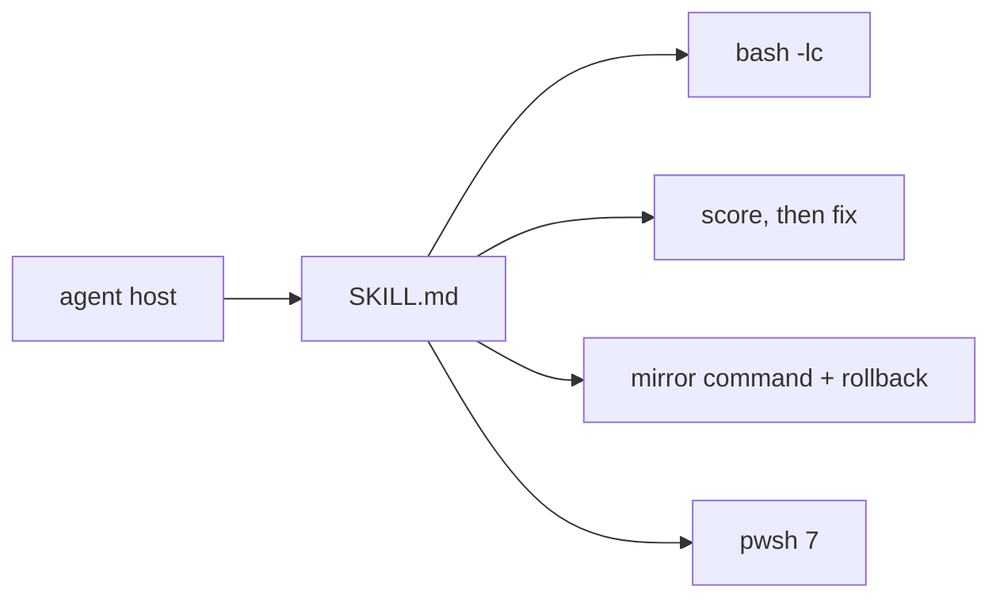

# public-skills

[中文](README.zh.md)

Agent skills that tell a coding agent how to write shell, how to audit AI-generated code, how to switch a package manager to a Chinese mirror, and how to run commands on Windows.

## What this is

Four self-contained skills. Each one is a single `SKILL.md`: YAML frontmatter the host can index, then the instructions the agent follows. Nothing here is a library, a CLI, or a package. Copy a skill directory into the agent's skills folder and the host loads it.

The frontmatter every skill ships:

| field | use |
| --- | --- |
| `name` | skill id, matches the directory name |
| `version` | semver, currently `1.0.0` on all four |
| `display_name` / `display_name_en` | short label, Chinese and English |
| `description` | when the host should load the skill |
| `description_zh` / `description_en` | the same trigger text, split by language |

## Skills



| skill | use | version |
| --- | --- | --- |
| [bash-first](skills/bash-first/SKILL.md) | Write shell as POSIX/bash, and wrap anything fish would misread in `bash -lc` | 1.0.0 |
| [no-slop](skills/no-slop/SKILL.md) | Score a diff 0–5 per category with `file:line` evidence, then delete, consolidate, rewrite — only after you confirm | 1.0.0 |
| [cn-mirror](skills/cn-mirror/SKILL.md) | Pick a Chinese mirror for a package manager, print the command and the rollback, point at MirrorZ | 1.0.0 |
| [win-powershell](skills/win-powershell/SKILL.md) | On Windows, run PowerShell 7 (`pwsh`), never `powershell.exe` 5.1, and search with `rg` | 1.0.0 |

### bash-first

Agents emit bash. If the host shell is fish, `set -e`, `${var:-default}`, `$?`, and a bare heredoc do the wrong thing, often without an error. The skill forbids fish-only syntax, wraps multi-line logic in `bash -lc`, and keeps a fish-to-bash translation table plus the silent traps.

Check a command before running it:

```bash
bash -n -c '<command>'
```

### no-slop

One pass over a scope the skill resolves in order: uncommitted (`git diff HEAD`), unpushed (`git diff @{u}...HEAD`), the open PR (`gh pr diff`), then the whole tree. Eight categories, each scored 0–5. A 5 in any category blocks, whatever the average is. The agent prints the scorecard and a fix list, then waits. It does not edit until you say so.

### cn-mirror

Trigger it when a download is slow inside China, or when you ask how to point a tool at a mirror. It probes the shell and the tool first (`echo $SHELL`, `which <tool>`), defaults to a session-only setting, and prints the undo command next to the setting.

The skill treats [MirrorZ Help](https://help.mirrorz.org/) as the source for which mirror is current. Slugs in the table are candidates: fetch `https://help.mirrorz.org/<slug>/` and keep the URL only if it returns 200.

| tool | default mirror the skill names |
| --- | --- |
| npm, pnpm, yarn | `https://registry.npmmirror.com` |
| pip, uv | TUNA PyPI |
| cargo, rustup | rsproxy.cn or USTC |
| Homebrew formula and bottles | TUNA |
| apt, Fedora, Alpine, Arch | TUNA or USTC; Alpine also names Aliyun |
| Go modules | `https://goproxy.cn,direct` |
| Maven | `https://maven.aliyun.com/repository/central` |
| git clone / GitHub raw / release | mapping table names gh-proxy.com or fastgit; later examples prefix with `https://ghfast.top` |
| Docker Hub | `dockerproxy.cn`, with the caveat that most public registry mirrors stopped working in 2024 |
| DNS | AliDNS `223.5.5.5`, DNSPod `119.29.29.29`, 114DNS, Baidu DNS |

Session-only examples the skill gives:

```bash
npm config set registry https://registry.npmmirror.com
npm config delete registry
```

```fish
set -gx UV_INDEX_URL https://mirrors.tuna.tsinghua.edu.cn/pypi/web/simple
set -e UV_INDEX_URL
```

### win-powershell

On Windows the agent stays in PowerShell 7. It does not call `powershell.exe`, and it does not nest `cmd.exe`, Git Bash, or WSL unless the task says to. Search goes to `rg`; `rg` exit code 1 means no match, not a failed command. If `pwsh` or `rg` is missing, the skill asks before installing:

```powershell
winget install --id Microsoft.PowerShell --source winget
winget install --id BurntSushi.ripgrep.MSVC --source winget
```

## Install

Copy one skill directory into the folder your agent reads skills from:

```bash
cp -R skills/bash-first /path/to/agent/skills/bash-first
```

Or point the host at `skills/<name>/SKILL.md` directly. Each skill is one file. There is no build step and no dependency to install.

## License

No license file is in this repository. Ask the author before you reuse the text.
