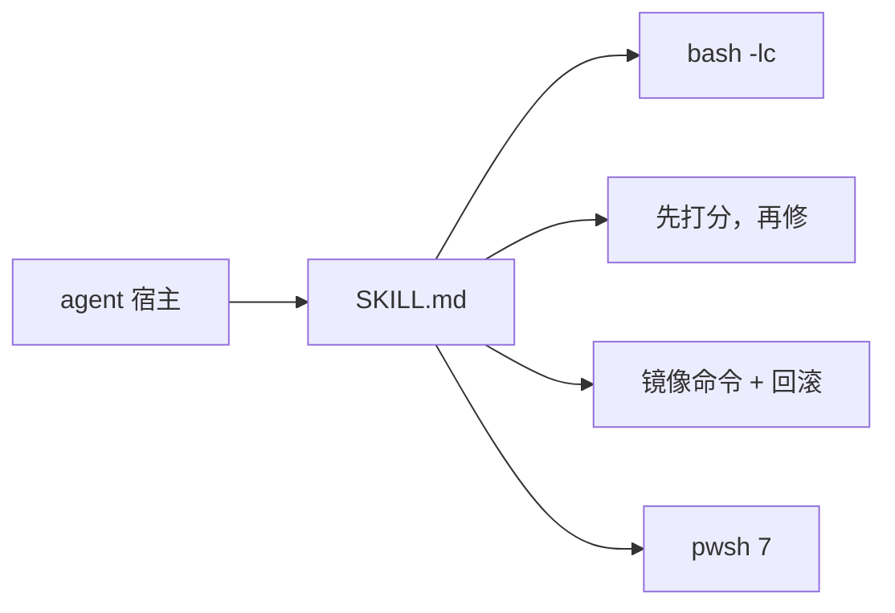

# public-skills

[English](README.md)

给 coding agent 用的四份 skill：怎么写 shell、怎么审 AI 生成的代码、怎么把包管理器换到国内镜像、在 Windows 上怎么执行命令。

## 这是什么

四份自包含的 skill。每份只有一个 `SKILL.md`：前面是宿主可以索引的 YAML frontmatter，后面是 agent 要遵循的指令。这里没有库、没有 CLI、也没有发布的包。把 skill 目录拷贝 agent 读 skill 的目录里，宿主就会加载它。

每份 skill 都带这些 frontmatter：

| 字段 | 用途 |
| --- | --- |
| `name` | skill id，与目录名相同 |
| `version` | semver，四份目前都是 `1.0.0` |
| `display_name` / `display_name_en` | 短标题，中文和英文 |
| `description` | 宿主什么时候加载这份 skill |
| `description_zh` / `description_en` | 同一段触发说明，按语言拆开 |

## Skills



| skill | 用途 | 版本 |
| --- | --- | --- |
| [bash-first](skills/bash-first/SKILL.md) | shell 按 POSIX/bash 写；fish 会读错的东西套进 `bash -lc` | 1.0.0 |
| [no-slop](skills/no-slop/SKILL.md) | 按类别给 diff 打 0–5 分，附 `file:line` 证据；先删、再合并、再改写，你确认之后才动代码 | 1.0.0 |
| [cn-mirror](skills/cn-mirror/SKILL.md) | 给包管理器选一个国内镜像，同时打印配置命令和回滚命令，并指向 MirrorZ | 1.0.0 |
| [win-powershell](skills/win-powershell/SKILL.md) | Windows 上用 PowerShell 7（`pwsh`），不用 `powershell.exe` 5.1，检索用 `rg` | 1.0.0 |

### bash-first

Agent 生成的是 bash。宿主 shell 如果是 fish，`set -e`、`${var:-default}`、`$?` 和裸 heredoc 会做错事，而且经常不报错。这份 skill 禁止只有 fish 认的语法，多行逻辑套进 `bash -lc`，并附一张 fish 到 bash 的对照表，加上那些静默陷阱。

跑之前先查语法：

```bash
bash -n -c '<command>'
```

### no-slop

一次过完一个范围。没有指定范围时按这个顺序取第一个非空的：未提交（`git diff HEAD`）、未推送（`git diff @{u}...HEAD`）、已开的 PR（`gh pr diff`）、整仓。八个类别，每个 0–5 分。任一类别得到 5 就是阻断项，不看平均分。Agent 先打出评分表和修复清单，然后等你。你没说可以之前它不改代码。

### cn-mirror

国内下载慢，或者你问某个工具怎么换镜像时触发。它先探测 shell 和工具（`echo $SHELL`、`which <tool>`），默认只给当前会话生效的写法，配置命令旁边一并打出撤销命令。

哪家镜像当前可用，以 [MirrorZ Help](https://help.mirrorz.org/) 为准。表里的 slug 只是候选：先请求 `https://help.mirrorz.org/<slug>/`，返回 200 才用这个 URL。

| 工具 | skill 里写的默认镜像 |
| --- | --- |
| npm、pnpm、yarn | `https://registry.npmmirror.com` |
| pip、uv | TUNA PyPI |
| cargo、rustup | rsproxy.cn 或 USTC |
| Homebrew formula 与 bottles | TUNA |
| apt、Fedora、Alpine、Arch | TUNA 或 USTC；Alpine 同时列了阿里云 |
| Go module | `https://goproxy.cn,direct` |
| Maven | `https://maven.aliyun.com/repository/central` |
| git clone / GitHub raw / release | 映射表写 gh-proxy.com 或 fastgit；后面的示例用 `https://ghfast.top` 做前缀 |
| Docker Hub | `dockerproxy.cn`；skill 同时写明，2024 年起大多数公开 registry 镜像已经失效 |
| DNS | 阿里 DNS `223.5.5.5`、DNSPod `119.29.29.29`、114DNS、百度 DNS |

skill 里的会话级示例：

```bash
npm config set registry https://registry.npmmirror.com
npm config delete registry
```

```fish
set -gx UV_INDEX_URL https://mirrors.tuna.tsinghua.edu.cn/pypi/web/simple
set -e UV_INDEX_URL
```

### win-powershell

Windows 上 agent 停在 PowerShell 7。不调 `powershell.exe`，也不嵌套 `cmd.exe`、Git Bash 或 WSL，除非任务明确要求。检索交给 `rg`；`rg` 退出码 1 表示没有匹配，不是命令失败。`pwsh` 或 `rg` 没装时，skill 要求先问过再装：

```powershell
winget install --id Microsoft.PowerShell --source winget
winget install --id BurntSushi.ripgrep.MSVC --source winget
```

## 安装

把一个 skill 目录拷贝你的 agent 读 skill 的目录：

```bash
cp -R skills/bash-first /path/to/agent/skills/bash-first
```

也可以直接让宿主指向 `skills/<name>/SKILL.md`。每份 skill 只有一个文件。没有构建步骤，也没有要装的依赖。

## 许可证

本仓库没有许可证文件。复用这些文本之前先问作者。
